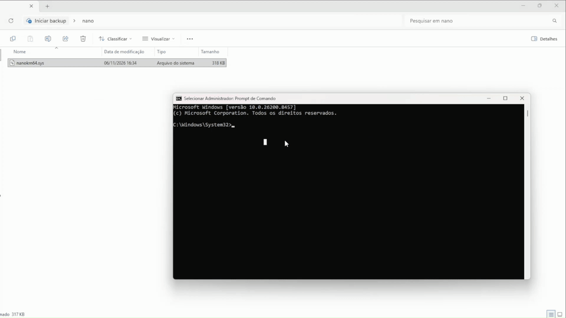
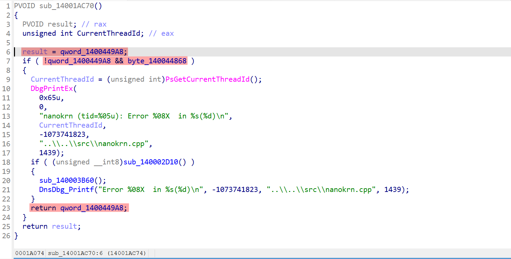
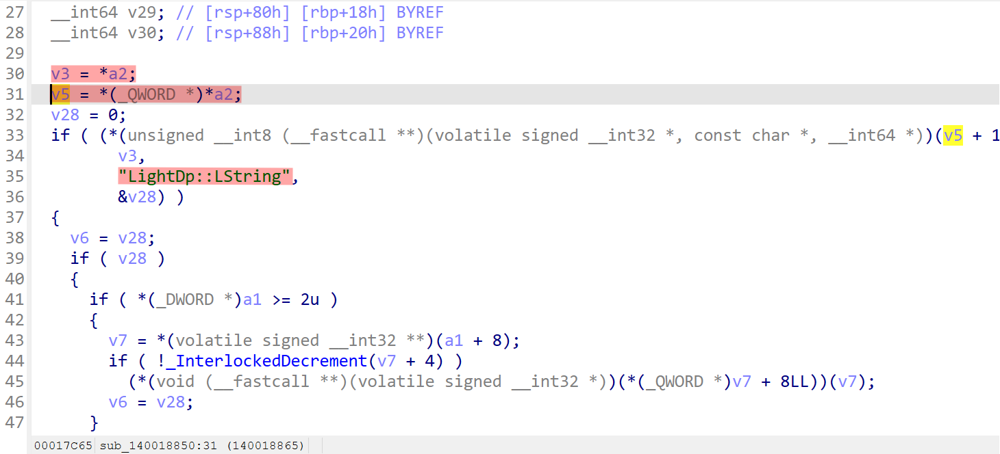

# nanokrn64.sys NULL Pointer Dereference

| Field | Value |
|---|---|
| **Vendor** | NANO Security / E-Style Software Corp. |
| **Product** | NANO Antivirus |
| **Filename** | nanokrn64.sys |
| **Version** | 1.0.358.510 |
| **PE TimeDateStamp** | 0x65F57999, 2024-03-16 |
| **Image Size** | 0x1450000 |
| **SHA256** | ccd0f67e2e0e3f65b7c75f472161160fd14ec5d10a6c304565d096a27c0a264c |
| **MD5** | 2273d8c80377479b4383afb809227e13 |
| **Tested OS** | Windows 11 Pro 10.0.26100.8457, x64 |
| **Vulnerability Class** | NULL Pointer Dereference, CWE-476 |

## PoC Demonstration



---

## Description

A NULL pointer dereference vulnerability exists in the kernel-mode driver nanokrn64.sys, a component of NANO Antivirus. The vulnerability is triggered during driver initialization when the driver is loaded without the parent security product's infrastructure. The driver fails to validate a NULL pointer before dereferencing it as a COM-like vtable, resulting in a Blue Screen of Death with bugcheck SYSTEM_THREAD_EXCEPTION_NOT_HANDLED, 0x7E.

### Root Cause

The driver's global configuration function sub_14001AC70, source nanokrn.cpp:1439, reads a global pointer qword_1400449A8 that is expected to be initialized by the parent product. When the parent product is absent, this pointer is NULL. The function logs an error via DbgPrintEx but returns NULL without aborting initialization:

**IDA Pro decompilation of sub_14001AC70:**



Highlighted lines: line 6 reads the global pointer, line 7 checks if NULL, line 23 returns NULL without aborting initialization.

```c
// sub_14001AC70 (reconstructed pseudocode matching IDA decompilation)
PVOID sub_14001AC70()
{
    result = qword_1400449A8;
    if ( !qword_1400449A8 && byte_140044868 )
    {
        CurrentThreadId = (unsigned int)PsGetCurrentThreadId();
        DbgPrintEx(0x65u, 0,
            "nanokrn (tid=%05u): Error %08X  in %s(%d)\n",
            CurrentThreadId, -1073741823,
            "..\\..\\src\\nanokrn.cpp", 1439);
        // ... DnsDbg_Printf logging omitted ...
        return qword_1400449A8;  // returns NULL (qword_1400449A8 == 0)
    }
    return result;
}
```

The NULL pointer propagates through the initialization chain until it reaches the LightDP type resolver function sub_140018850, source ldpbase_imp.h:63, which immediately dereferences it as a vtable pointer without validation:

**IDA Pro decompilation of sub_140018850:**



Highlighted lines: line 30 loads the object pointer from *a2, line 31 dereferences it as vtable. When the pointer is NULL, the instruction at line 31 causes BSOD.

```c
// sub_140018850 (reconstructed pseudocode matching IDA decompilation)
// Lines 30-31 visible in screenshot:
    v3 = *a2;                    // line 30: loads object pointer (NULL)
    v5 = *(_QWORD *)*a2;        // line 31: CRASH - dereferences NULL as vtable
    // line 33-36: calls QueryInterface via vtable for "LightDp::LString", ...
```

### Crash Details

```
Bugcheck:  SYSTEM_THREAD_EXCEPTION_NOT_HANDLED (0x7E)
Exception: STATUS_ACCESS_VIOLATION (0xC0000005)
Address:   nanokrn64+0x18865
Instruction: mov rax, qword ptr [rcx]   ; RCX = 0x0000000000000000
Access:    Attempt to read from address 0x0000000000000000

Registers at crash:
  RCX = 0x0000000000000000  <- NULL object pointer
  RBX = 0xFFFFAB0CB0902000  <- device object
  RIP = 0xFFFFF8000B6F8865  <- nanokrn64+0x18865
```

### Call Stack

```
nanokrn64+0x18865        <- CRASH: NULL vtable dereference
nt!ExAcquireFastMutex+0x1b
nanokrn64+0x1FE4A        <- initialization caller
```

## Impact

- **Availability:** HIGH - Complete system crash (BSOD) requiring hard reboot. All unsaved work across all user sessions is lost.
- **Integrity:** NONE
- **Confidentiality:** NONE

Local administrator privileges are required to load the driver via sc create + sc start. If the product is installed normally and the driver loads at boot, the attack surface may differ.

## Proof of Concept

```
sc create nanokrn type= kernel binPath= C:\Temp\nanokrn64.sys
sc start nanokrn
```

The system immediately blue-screens with bugcheck 0x7E. After reboot, the crash dump is available at C:\Windows\Minidump\.

### Evidence
WinDbg !analyze -v output, relevant excerpt:

```
SYSTEM_THREAD_EXCEPTION_NOT_HANDLED (7e)
Arg1: ffffffffc0000005  The exception code that was not handled
Arg2: fffff8000b6f8865  The address where the exception occurred, nanokrn64+0x18865
Arg3: ffffa5043ce92348  Exception Record Address
Arg4: ffffa5043ce91b50  Context Record Address

EXCEPTION_RECORD:
  ExceptionAddress: fffff8000b6f8865, nanokrn64+0x18865
  ExceptionCode: c0000005, Access violation
  ExceptionFlags: 00000000
  NumberParameters: 2
  Parameter[0]: 0000000000000000  read operation
  Parameter[1]: 0000000000000000  from address NULL
```

## Recommended Fix

1. **Abort initialization on NULL config** - When sub_14001AC70() returns NULL, the caller in sub_14001BBA0 should return STATUS_UNSUCCESSFUL and unload cleanly instead of continuing execution.

2. **Add NULL validation in type resolver** - sub_140018850 should check `*a2 != NULL` before accessing the vtable:
```c
if (!*a2) return ERROR_INVALID_PARAMETER;  // or appropriate error code
```

Either fix alone prevents the BSOD. Both should be applied for defense in depth.

## Timeline

- 2026-11-06: Vulnerability discovered via crash dump analysis
- 2026-11-08: CVE requested
